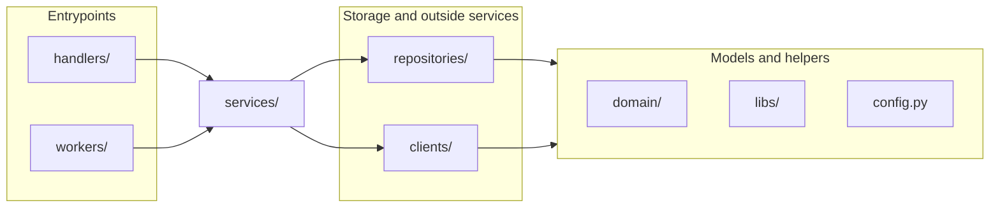

# Layers

How the videos service is split into layers, which way the imports point, and where a new
piece of code goes. Adapted from the API Layering Architecture standard, which in turn
follows Robert C. Martin's *Clean Architecture*.

## Principles

1. **Imports point inward.** `handlers`/`workers` → `services` → `repositories`/`clients` →
   `domain`. No cycles. *(Clean Architecture: Dependency Rule, Acyclic Dependencies)*
2. **Depend on what changes less.** `domain` changes least, handlers most.
   *(Stable Dependencies)*
3. **One job per layer.** *(Single Responsibility)*
4. **Extend at the edge.** A new endpoint, API version, or job adds an entrypoint; the core
   stays untouched. *(Open–Closed)*
5. **One model per noun.** A `Video` carries every fact; the service decides who sees what.
6. **Facts live next to the data.** Derivable from a row → the repository builds it;
   derivable from the model → a property.
7. **Start in the handler.** Move logic to a service when a second caller appears.

**Our one shortcut:** services import repositories and clients directly, not through
interfaces. We add an interface (Dependency Inversion) when a seam needs a second
implementation. Auth already works that way: the generated router owns the `Authenticator`
protocol, and `app.py` plugs in `clients.auth`.

## The layers

Every arrow is an allowed import. Anything an arrow can't reach, the layer doesn't import.

| Layer | One job |
|---|---|
| `handlers/` | Own the HTTP contract: parse the request, call services, shape the response. |
| `workers/` | Own a job's entry: take the job id, call a service, exit. |
| `services/` | The business rules: one function per operation, policy, orchestration. |
| `repositories/` | Talk to Postgres and build models from rows. One module per aggregate. |
| `clients/` | Wrap one outside service each: R2, Cloud Run, FFmpeg, auth. |
| `domain/` | Entities, their enums, and domain errors. Nothing else. |
| `libs/` | Pure helpers any layer can use: no I/O, no project imports above them. |
| `*/generated/` | Written by the code generator from `api-specs/`. Never edited by hand. |

Every layer passes the same `domain` entities. A handler holds a `Video` it got from a
service; it never builds one from raw data, and it changes one with `dataclasses.replace`.

## Where does this code go?

Ask in order; the first yes wins.

1. **Is it a fact about the thing?** A field on the entity in `domain/`, or a read-only
   property when other fields already decide it.
2. **Is it built from stored data?** The repository: row to entity, enum strings to members.
3. **Does it exist because of how the work arrives or what the contract promises?** Status
   codes, wire field names, response shape → the handler (or the worker).
4. **Anything else, or a URL that needs config?** The service. When you can't tell yet,
   start in the handler and move it when a second caller appears.

Two endpoints that return the same shape today still map it separately: they are two
contracts that happen to agree.

## The composition root

`app.py`, `extensions.py`, and each worker's `run()` wire the service together: they open
the database pool and the storage and job clients, plug the auth client into the generated
router, and close everything on the way out. They are the only code that reaches every
layer, and only to start and stop things.

## Where we differ from the standard

| The standard | Here | Why |
|---|---|---|
| `models/` | `domain/` | Same contents under this service's existing name. |
| Errors in `services/exceptions.py` | Errors in `domain/` | `domain/` is the one vocabulary every layer shares, errors included. |
| aiohttp and Marshmallow | FastAPI and generated Pydantic schemas | The generator targets FastAPI. |
| Versioned handlers (`v4/`, `v5/`) | One version, `/v1` | Principle 4 still holds; the second version gets its own handlers. |
| Grep checks | `import-linter` contracts | They fail `make check` and CI instead of relying on a reviewer. |

## How it's checked

`make layers` (part of `make check`) runs the contracts in `pyproject.toml`:

| Contract | Guards |
|---|---|
| Imports point inward | Principles 1–3. Layers import only downward, siblings (`repositories`/`clients`, `domain`/`libs`/`config`) not each other. |
| Entrypoints reach storage and outside services through a service | Principle 1. The worker's lifecycle imports are the listed exception. |
| Wire types stay at the edge | Principle 4. No FastAPI, Pydantic, or generated schemas below the handlers. |
| Only repositories touch the database driver | Principle 3. `psycopg` stays in `repositories/`. |

Placement (principles 5–7) is judgment the linter can't make; reviews check it against
*Where does this code go?*
