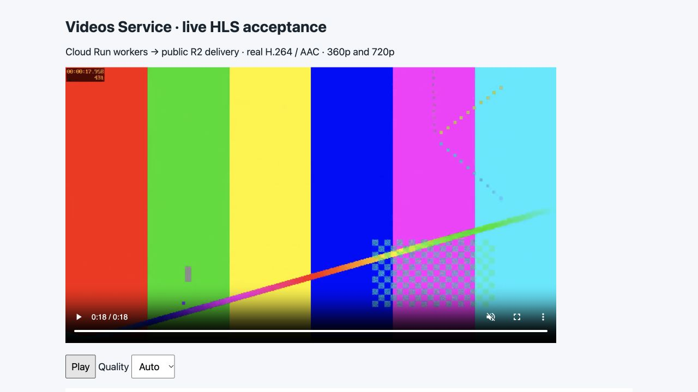
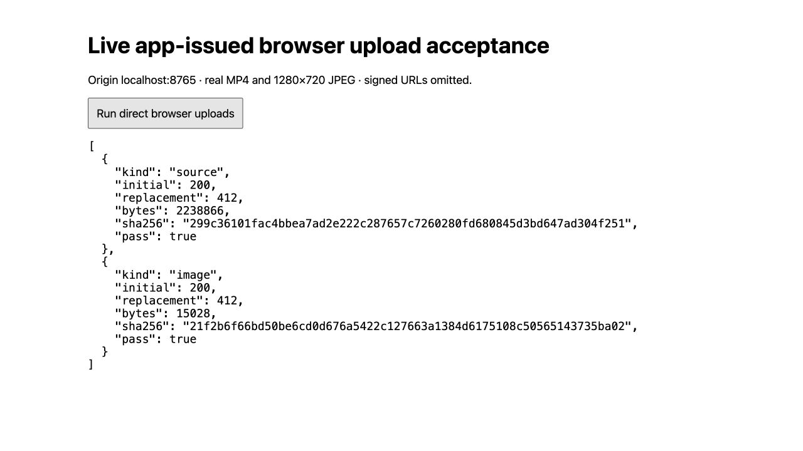

# Live showcase acceptance — 2026-10-16

**MEL-16 live acceptance criteria are verified.** These are actual deployed-service, R2 and browser
observations. [Cloud readiness](cloud-readiness.md), [deployment identities and
image pins](cloud-deployment.md), and [native worker measurements](cloud-worker-resources.md)
record the completed prerequisites independently.

## Deployed application and media checks

The [sanitized final live result](evidence/live-showcase-result-2026-10-16.json)
records these completed observations through the deployed API, actual Neon,
Cloud Run jobs and R2:

| Check | Observed result |
| --- | --- |
| Source attempts | Renewal supersedes stale confirmation; repeat accepted confirmation is idempotent and accepted originals reject replacement. |
| Independent media jobs | VIDEO and THUMBNAIL each reached SUCCEEDED on their first application attempt; valid custom thumbnail selection and generated fallback were exercised. |
| Publication and viewers | Published visibility and idempotent publication timestamp passed; actual search parameter positive and negative cases passed. |
| Current-role authorization | The same still-valid Neon JWT was denied through deployed HTTP immediately after administrator demotion. |
| Original isolation | Authenticated private-original positive control passed; its key was unavailable through public delivery. |
| First source HLS | Three public playlists and ten segments were fetched and actual remote media decoding passed. |

## Actual cancellation, recovery and five-minute output

The 300-second, 1280×720, 12-fps AAC fixture contains **25,070,681 bytes**.
Cloud Run execution `videos-worker-gltdb` was actually cancelled and its terminal
condition confirmed before the explicit local operator recovery command used
`--gcloud-auth` and `--previous-execution-terminated`. The persisted first claim
remained RUNNING until recovery recorded **INTERRUPTED**, then a new claim
completed **SUCCEEDED** on application attempt **2**. The replacement Cloud Run
execution is `videos-worker-krd85`; native task elapsed time is **230.455 seconds**,
with zero platform retries.

Actual output duration is **300.0 seconds**. All **three playlists and 150
segments** were fetched from public delivery and the remote HLS media decoded
successfully with the real media toolchain. This establishes media and persisted
state evidence beyond the platform execution's success alone.

## Actual browser playback

The temporary localhost:8765 acceptance harness played the published 18-second
fixture through its public R2 HLS delivery URL using **hls.js 1.7.3**. It offered
360p and 720p; playback at 720p advanced from zero through 14 seconds and reached
the **18.07-second** end. Browser state reported readyState 4, zero dropped frames
and no media error. This establishes actual browser playback of the retained
published fixture, rather than playlist fetching alone.

[Sanitized playback observations](evidence/live-hls-player-result-2026-10-16.json)
accompany the unchanged browser screenshot:



## Application-issued direct browser uploads

The deployed API issued the MP4 and 1280×720 JPEG upload instructions. Actual
browser PUTs from localhost:8765 each returned **200** initially and **412** when
attempting different replacement bytes. Independent authenticated S3 GETs using
the verified runtime credential returned **200** and confirmed both original
lengths and SHA-256 digests after those replacement attempts:

| Object | Bytes | SHA-256 |
| --- | --- | --- |
| MP4 source | 2,238,866 | `299c36101fac4bbea7ad2e222c287657c7260280fd680845d3bd647ad304f251` |
| JPEG image | 15,028 | `21f2b6f66bd50be6cd0d676a5422c127663a1384d6175108c50565143735ba02` |

These actual application-issued PUTs prove the required R2 browser CORS,
including Content-Type and If-None-Match. Actual public HLS browser playback above
also proves its delivery CORS. A separate cross-origin frontend/API interface is
outside the approved scope; there is no additional “application CORS” gate.

The [browser result](evidence/live-browser-put-result-2026-10-16.json) and
[independent private GET result](evidence/live-browser-private-get-2026-10-16.json)
contain no credentials, signed URLs or media payloads. The screenshot is retained
unchanged:



## Browser-uploaded media through the real pipeline

The actual browser-uploaded **2,238,866-byte MP4** reached READY through two
independent SUCCEEDED media jobs. The browser JPEG was decoded and activated as
CUSTOM; removal returned the GENERATED fallback. A duplicate image completion
after removal returned **409**, preserving supersession. This extends the direct
PUT proof above through actual application confirmation and cloud processing.

## Invalid-source and identity-availability observations

An actual **47-byte corrupt source** and a real **301-second source** (97,084
bytes) each failed both VIDEO and THUMBNAIL jobs with `INVALID_SOURCE` on
application attempt **1**, without automatic retries. Explicit source retry for
the corrupt case returned **409**.

A separate real R2 object contained **104,857,601 bytes** (100 MiB + 1), despite
its declared size of one byte. Confirmation returned **413**, preserved the video
in UPLOADING and created **zero jobs**. Each of these three disposable records
then completed explicit guard cleanup and returned **404**.

During confirmation, one observed **503** carried the safe detail “Identity
verification is temporarily unavailable.” The same idempotent confirmation later
returned **202** and the actual corrupt-media rejection above followed. This
establishes fail-closed identity handling and recovery from that observed
availability interruption. The lower-level transport cause and response latency
were not measured. These observations used the existing deployed image and actual
providers. The long acceptance run also outlived a normal 900-second Neon JWT;
the API correctly returned **401**, and a fresh sign-in allowed final cleanup.
No application change was needed.

## Guarded deletion during actual cloud processing

The 300-second in-flight video worker was RUNNING with **153 finite output keys
registered** and only **two already written** when DELETE was accepted. The
custom image had already been accepted and projected CUSTOM before generation
completed. Explicit cleanup sealed **four private objects and 155 public
objects** as guards, including registered outputs that did not yet exist.

Every verified guard has zero bytes, content type
`application/x-pilgrims-deletion-guard`, metadata `pilgrims-deletion-guard=1` and
`Cache-Control: no-store`. The video eventually returned **404** and its job rows
were removed by cascade. A still-valid old source upload URL returned **412** on
a late PUT, proving the guard rather than token expiry prevented replacement.
After the original media execution `videos-worker-mmhpz` terminated, every
remaining public object was still zero bytes: the late cloud worker did not
recreate media after row removal. Its sanitized CLI outcome was **no_op** at
16:24:36 UTC. Native task duration was 147.636 seconds; cleanup execution
`videos-worker-2mrpz` completed successfully in **83.708 seconds**, with zero
platform retries.

## Actual expiry, renewal and disposable-fixture cleanup

The original authorization expired at **2026-10-16T15:13:10.486156Z** after its
real **900-second** lifetime. An actual expired R2 PUT returned **403**. Renewed
instructions for the **same video record** returned **200** on PUT; stale
confirmation returned **409**. This uses real provider expiry rather than a
simulated clock or an application-only expiration assertion.

Completed explicit cleanup has the following verified guard counts and eventual
video 404 results:

| Disposable fixture | Private guards | Public guards |
| --- | --- | --- |
| In-flight processing | 4 | 155 |
| Recovered 300-second source | 1 | 307 |
| Browser upload pipeline | 1 | 14 |
| Corrupt source | 1 | 0 |
| 301-second source | 1 | 0 |
| Actual 100 MiB + 1 admission case | 1 | 0 |
| Expiry and renewal | 2 | 0 |

The recovered source's **307** public guards include the reserved output
namespace from the cancelled attempt and its replacement. All 307 HEAD responses
verified zero bytes, marker content type/metadata and no-store; job rows cascaded.
The old expired PUT remained 403. These keys must remain sealed permanently.

Final expiry cleanup verified both exact zero-byte guards, eventual video
**404**, cascaded jobs and an old expired PUT still returning **403**. Every
non-happy acceptance video returns **404** and has **zero job rows**.

The sole retained interview fixture is **READY / PUBLISHED**, duration **18.0
seconds**, with the **GENERATED** thumbnail. Final application inventory is
**one video, five upload attempts and two jobs**. The synthetic demo role is
restored to **user**; the one other administrator remains unchanged. Permanent
guards remain in storage. Stop the temporary localhost acceptance harness after use; no full frontend or
scheduled cleanup is introduced.

## Reviewer commands and inputs

Public reads require no credential:

```sh
api='https://videos-api-z2kxcj7fsa-uc.a.run.app'
video='ceb8f659-9090-4f5a-9be1-f3c8fb5864be'
curl --fail --silent --show-error "$api/ping"
curl --fail --silent --show-error "$api/v1/videos"
curl --fail --silent --show-error "$api/v1/videos/$video/playback"
```

The playback response supplies the public HLS master URL for the retained
18-second fixture. The browser proof above uses real H.264/AAC media at 360p/720p.
The recovery boundary fixture is exactly 300 seconds, 1280×720 at 12 fps with
AAC audio; negative fixtures are a 47-byte corrupt payload, a 301-second video,
and a 104,857,601-byte object declared as one byte.

Run the repeatable local HTTP/PostgreSQL/media journey with a dedicated local
test database and FFmpeg/FFprobe available:

```sh
make showcase
```

[Local showcase setup](showcase.md) describes the controlled provider boundaries
and private `TEST_DATABASE_URL` configuration. It creates isolated test schemas;
use a local test database, never the deployed database.

For a real interrupted job, first confirm the prior Cloud Run task has terminated
using the [execution correlation commands](cloud-deployment.md). Supply the
runtime database/settings privately and authenticate the intended gcloud account
with job-scoped launch permission, then run:

```sh
uv run --locked python -m src.worker recover --job-id JOB_UUID \
  --gcloud-auth --previous-execution-terminated
```

`JOB_UUID` is the existing persisted interrupted job. The termination flag is an
operator assertion made only after checking the actual prior execution; it does
not cancel the execution. Credentials and upload URLs stay outside this guide
and version control.
